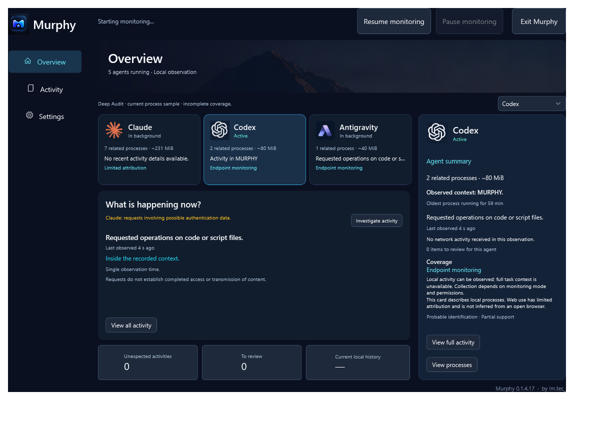
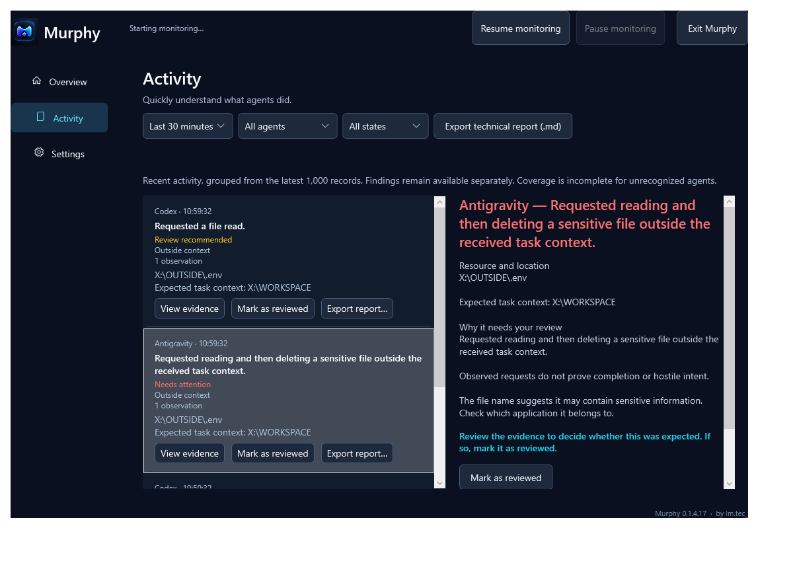

# Murphy

**Know what happened. The agent does not audit itself.**

Murphy is an independent, local-first activity verification layer for AI agents running on Windows. It helps you understand observed process, file and network activity without relying on the agent to audit itself.

This is the public presentation and documentation repository. Murphy's proprietary product source code, internal tests and runtime evidence are not included.

**Current product version: 0.1.4.17.** No executable, installer or public download is distributed through this repository yet.

## What you can see

- Which recognized agents have running processes, and whether relevant work was recently observed.
- Recent activity grouped into understandable summaries, with technical details available separately.
- Normal, Review and Attention states, and a workflow for reviewing findings.
- Observed activity compared with task context received through a supported, enabled integration.
- Local technical reports exported while monitoring continues.

Standard mode observes supported process and network activity. File-request visibility requires Deep Audit and Windows elevation. Coverage depends on the agent, available evidence and monitoring mode.

## Three principles

- `request != completion`: an observed request does not prove that an operation succeeded.
- `correlation != causality`: related observations do not establish why an action happened.
- `Unexpected != threat`: a context deviation is not automatically malicious.

Murphy helps you investigate. It does not promise attack prevention, infallible detection, proof of exfiltration, authenticated intent or complete Windows coverage. Task context is cooperative information, not human authorization.

## Product views

These are unedited captures of the real Murphy 0.1.4.17 interface rendered with synthetic validation data. They illustrate the UI, not live actions performed by the named agents. Paths and counts belong to the demonstration fixture.

See [screenshot context](docs/SCREENSHOTS.md) for the scope of these images.

## Documentation

- [Getting started](docs/GETTING_STARTED.md)
- [Compatibility and coverage](COMPATIBILITY.md)
- [How Murphy works](docs/HOW_IT_WORKS.md)
- [Task context](docs/TASK_CONTEXT.md)
- [Normal, Review and Attention](docs/NORMAL_REVIEW_ATTENTION.md)
- [Illustrative report](docs/EXAMPLE_REPORT.md)
- [Privacy](PRIVACY.md), [security](SECURITY.md) and [known limitations](KNOWN_LIMITATIONS.md)
- [Public changelog](CHANGELOG.md)

The Windows interface and user-facing reports support English (United States) and Portuguese (Brazil). This public documentation starts in English.

Murphy is proprietary. Publishing these materials does not publish its source code or grant an open-source license to the product. No content license has been added in this initial publication.
