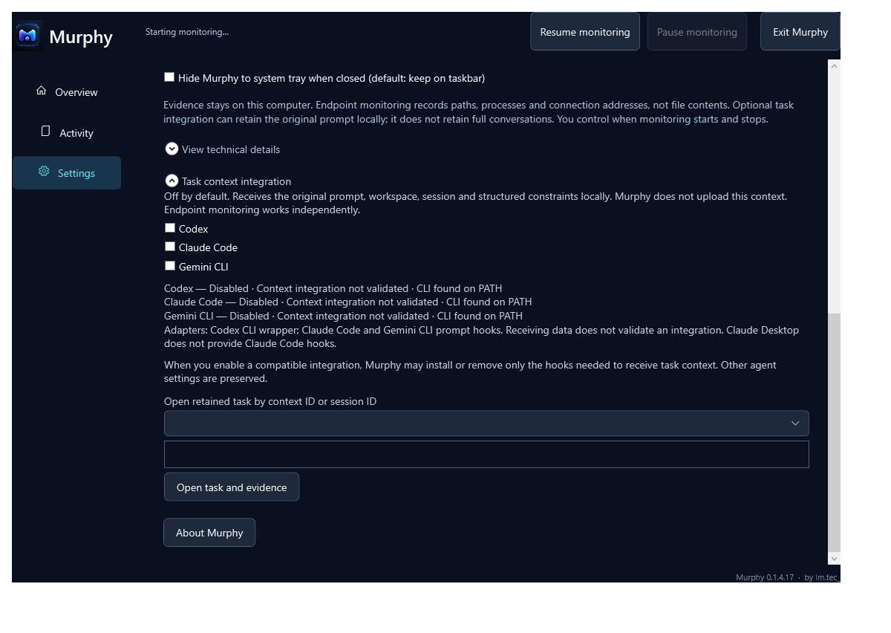

# Screenshot context

The images are unedited captures of the actual Murphy 0.1.4.17 WPF interface from controlled local UI validation. Their activity, paths and counts are synthetic demonstration data. They are not evidence of actions by real Claude, Codex or Antigravity sessions.

- `home.png`: overview demonstration, with an illustrative background notice. It is not a clean live-session certification; the startup label is part of the captured fixture state. The demonstration workspace label MURPHY refers to the product fixture, not a private customer project.
- `activity.png`: synthetic yellow Review and red Attention examples in the simplified Activity interface. The displayed drive paths are fictional.
- `task-context.png`: the integration settings screen with integrations disabled. It does not depict an enabled or fully correlated task.

No screenshots have been generated, retouched, relabeled or reconstructed for this publication. Dedicated public screenshots of an enabled task context and separate Claude Code/Desktop cards are not included because the available selected captures do not demonstrate those states.

